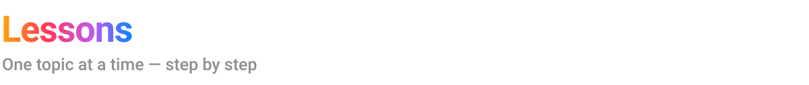
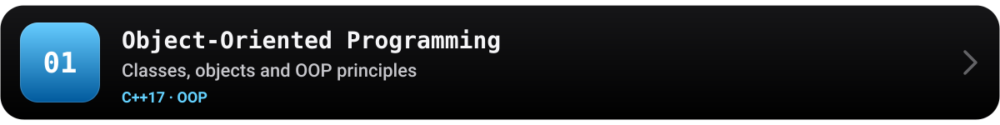
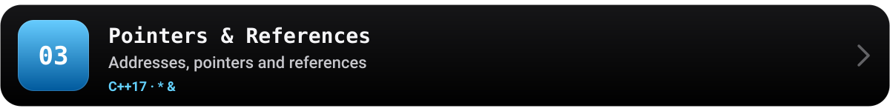
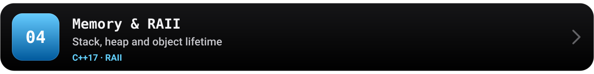
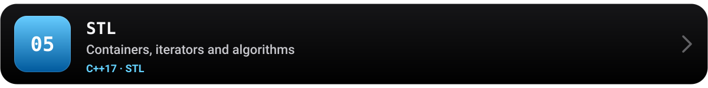
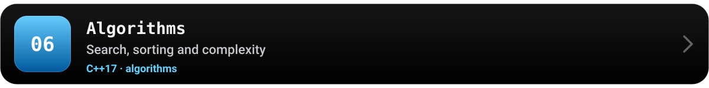
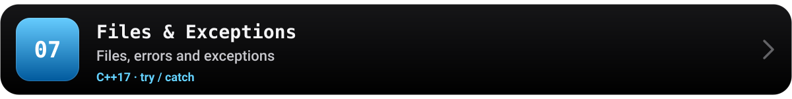
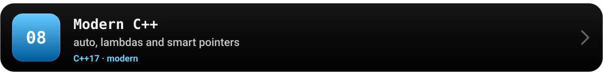

<b>English</b> &nbsp;|&nbsp; <a href="README.ru.md">Русский</a>

  I repeat <b>Object-Oriented Programming</b> in C++ step by step, one topic at a time. 
  A little theory + small code examples, compiled with <code>clang++ -std=c++17</code>.

 

  Made with ☕ and <code>-std=c++17</code> · <a href="https://github.com/Doosi41">@Doosi41</a>

