<p align="center"><b>Русский</b> &nbsp;|&nbsp; <a href="README.md">English</a></p>

<a href="#lessons"></a>

<p align="center">
  Повторяю <b>объектно-ориентированное программирование</b> на C++ шаг за шагом, по одной теме за раз.<br>
  Немного теории + небольшие примеры кода, компилирую через <code>clang++ -std=c++17</code>.
</p>

<br>

<a name="lessons"></a>
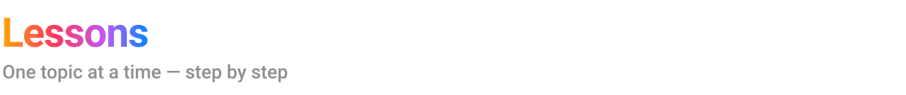

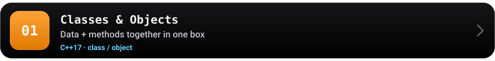
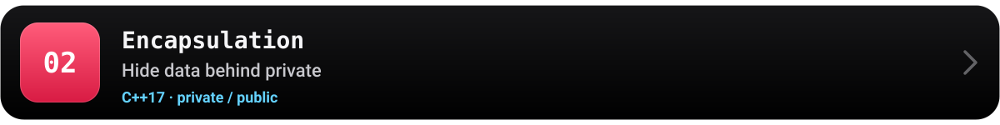
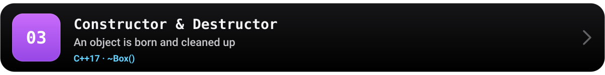
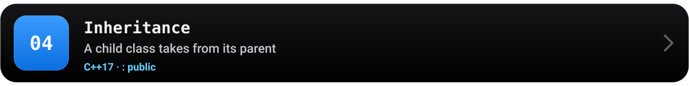
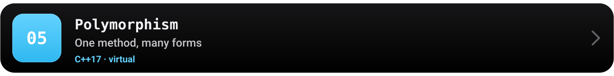
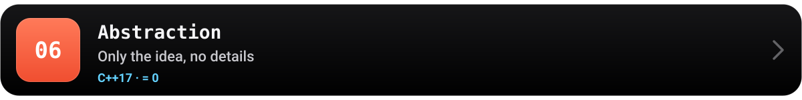
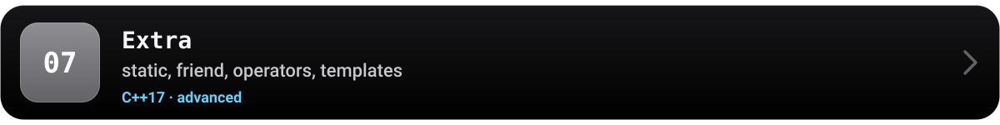

<br>
<br>

<a name="run"></a>
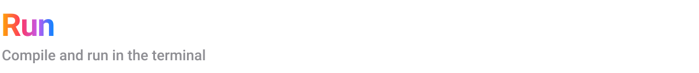

```bash
# компиляция
clang++ -std=c++17 OOP/01_encapsulation.cpp -o box

# запуск
./box
# Volume of Box: 210
```

<br>

<a name="structure"></a>
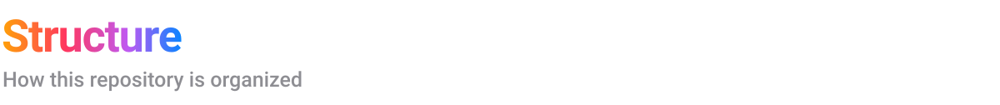

```
repeat/
├── OOP/                      ← уроки (теория + код)
│   ├── principles.md
│   ├── 01_encapsulation.cpp
│   └── ...
├── assets/                   ← все неоновые картинки
│   ├── hero.svg
│   ├── titles/
│   └── lessons/
├── README.md
└── README.ru.md
```

<br>


<p align="center">
  <sub>Сделано с ☕ и <code>-std=c++17</code> · <a href="https://github.com/Doosi41">@Doosi41</a></sub>
</p>
